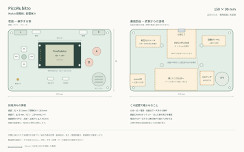

# WeAct親基板の配置案 A

150×90mmの横持ち型ゲーム機を想定した概略配置です。外形、部品位置と操作感を検討する
段階で、回路図・配線済みPCB・製造データはまだ作成していません。

[表面だけの原寸確認図](hardware-layout-front.svg)も用意しています。ブラウザ等で印刷するときは
倍率100%とし、150mmの寸法線を実測してください。全体図は356×222mmのためA3横相当、
表面図は178×120mmのためA4に収まります。印刷ソフトによる自動縮小に注意してください。

## 採用情報と仮定

| 項目 | 配置に使う値 | 根拠・状態 |
| --- | --- | --- |
| 画面モジュール | GMT020-02 VER:1.1、横向き62×37.5mm | ユーザー提供の製品写真とGrabCAD由来の寸法図。現物照合前 |
| 画面取付穴 | φ2.6mm、中心間58×28.6mm | 同寸法図。基板端から左右2mm、上下4.45mmと読める |
| 画面基板・全体厚さ | 基板1.6mm、図示の全体4.2mm | 同寸法図。実装するピンヘッダやソケットによる増分は別途確認 |
| 画面の端子 | 1列7ピン、2.54mmピッチ | 製品写真とユーザー確認。端子の基板に対する絶対位置は未確定 |
| 表示領域 | 40.8×30.6mmを横向きに表示 | 既出のパネル資料に基づく仮の中央配置。窓の位置・開口寸法は現物で確定 |
| WeAct | RP2350B Core Board、8MB PSRAM | 約42×42mmの配置領域を仮確保。ソケットとUSB・ボタン操作の逃げは詳細設計で追加 |
| 親基板 | 150×90mm、角R5mm | 今回の提案。ケース寸法を含まない |
| 電池 | 単3×2本 | 現在の実機ガイドに合わせた仮定。ホルダーは仮の62×32mm領域 |
| その他の部品 | microSD、昇圧、MAX98357A、スピーカー、ダイヤル | 型番・寸法未確定。図中の点線領域は実フットプリントではない |

画面の7ピンは隣接中心間2.54mm、端から端のピン中心間15.24mmになります。図の端子位置は
模式表示です。図面から端子の絶対位置を逆算してフットプリントを確定しないでください。

## 表面の配置座標

表面を正面から見て左上を(0,0)、右をX+、下をY+とします。単位はmmです。
裏面の図も同じ座標系の透視図で、実際に裏返して見たときの図ではありません。

| 部品 | 中心または左上 | 寸法・補足 |
| --- | --- | --- |
| 画面基板 | 左上(44,19) | 62×37.5 |
| 画面取付穴 | 中心(46,23.45)、(104,23.45)、(46,52.05)、(104,52.05) | φ2.6。ネジ頭・ワッシャ・スペーサーの径は別途確保 |
| 十字キー | 中心(23,40) | 上(23,29)、下(23,51)、左(12,40)、右(34,40)。中央の丸は支点のイメージで追加ボタンではない |
| A / B | 中心(129,32) / (118,48) | 図はφ12のキャップ。実スイッチとキャップを選定する |
| SELECT / START | 中心(62,72) / (84,72) | 仮の操作面10×4 |
| L / R | 中心(18,4.5) / (132,4.5) | 上端から押す肩ボタン。スイッチ方向・ケースの押し子は未設計 |
| 電源 / 音量 | 中心(41,3.5) / (109.5,4) | 上端から操作する仮位置 |
| 電池LED | 中心(14,73) | GP24。画面や握る位置と離す |
| スピーカー | 中心(132,73) | φ20の仮領域。音穴・固定・配線は詳細設計で確定 |
| ケース固定穴 | 中心(5,5)、(145,5)、(5,85)、(145,85) | φ3の仮位置。画面取付穴とは別 |

十字キーとA/Bは画面の左右、SELECT/STARTは画面下です。肩ボタン、電源と音量は上端に
まとめます。操作部品のサイズと持ちやすさは原寸の紙模型で確認してから外形を決めます。

## 裏面と高さ方向

- WeActは中央上寄りの(54,0)から42×42mmの領域。USB-Cは上向きで、ケースの開口から
  ケーブルを挿します。USBコネクタ、プラグの太さ、BOOT/RESET操作、SWD接続の空間を確保します。
- microSDは左下端から交換する案です。カードの挿抜方向とソケット方式は部品選定で確定します。
- 昇圧モジュールは左上、音声アンプは右下に分け、アンプからWeActへの低インピーダンスな
  GND経路を確保します。図の点線は配線の方向を示す目安で、実配線ではありません。
- 単3ホルダーは中央下の背面ケースに固定する案です。親基板から浮かせ、SELECT/STARTの
  はんだ部を避けます。図の62×32mmは場所の仮確保で、電池ホルダーの実寸ではありません。
- 表面の画面と裏面のWeActは重ねて置きます。ソケットの貫通ピン、はんだ、画面裏の部品や
  金属面が干渉しない高さを確保します。画面用スペーサー長、ケース厚、全体厚は未確定です。
- 画面端子は2.54mmピッチの接続を前提とします。直結ソケットの位置は実測後に決定し、
  必要なら短いケーブル接続へ変更します。

## 配線に引き継ぐ設定

現在のWeAct向けファームウェア構成を使います。詳細は[実機ガイド](hardware.md)を参照してください。

- TFT SCK/MOSI/RST/DC/CS：GP18/19/20/21/22。
- 画面の裏面写真の端子順：CS、DC、RST、SDA、SCL、VCC、GND。親基板側の見える面と
  コネクタの向きを確認して番号を定義します。VCCの給電は実装モジュールの回路確認後に確定します。
- 十字キー：GP2/3/4/5、A/B：GP6/7、L/R/START/SELECT：GP9/12/14/16。GPIOとGND間の独立接点。
- SD MISO/CLK/MOSI/CS：GP8/10/11/13。
- I2S BCLK/WS/DATA：GP26/27/28。音量ダイヤル中央：GP42、電池測定：GP40、電池警告LED：GP24。
- GP0はPSRAM用に予約します。
- 電池とUSBの同時接続時の電源切替・逆流防止、昇圧回路、各電源の容量は回路図段階で確定します。

## 詳細設計前の確認

1. この150×90mmの外形とボタン配置を紙模型で確認する。
2. 画面の外形・取付穴、7ピンの絶対位置、端子方向と高さを現物で照合する。
3. WeActの実物とメーカー図面からソケット・USBの位置と高さを確定する。
4. ボタン、ダイヤル、SD、アンプ、スピーカー、電源、電池ホルダーの型番を決める。
5. 回路図、電源設計、実フットプリントと高さの照合後、基板配線へ進む。

参照：ユーザー提供の画面寸法図・製品写真、[WeAct公式HDK](https://github.com/WeActStudio/WeActStudio.RP2350BCoreBoard/tree/main/HDK)。
第三者の画面寸法図と製品写真は、このリポジトリには転載していません。
